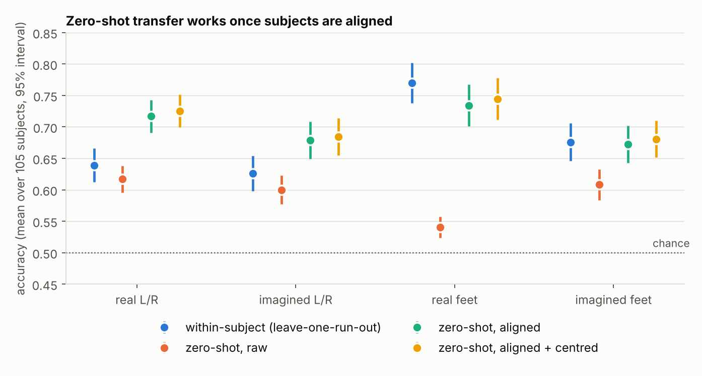
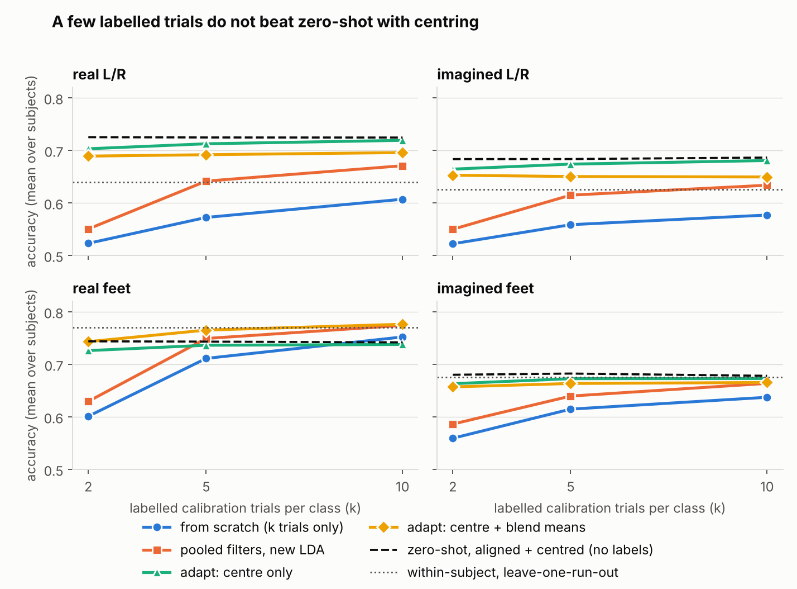
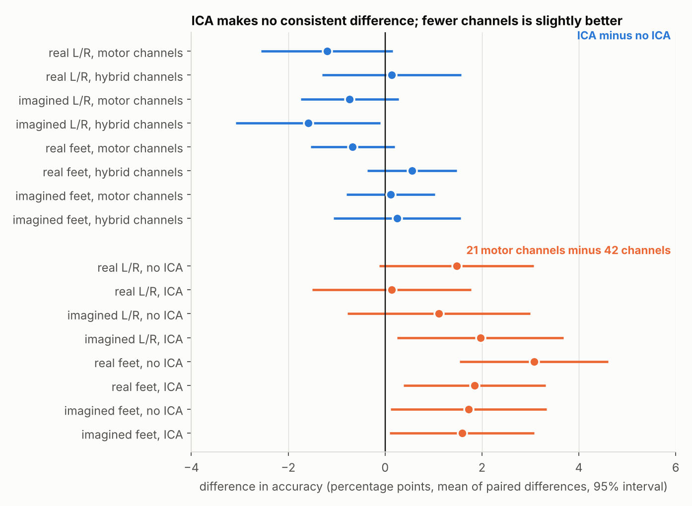
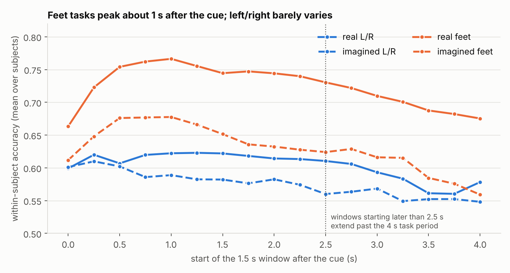
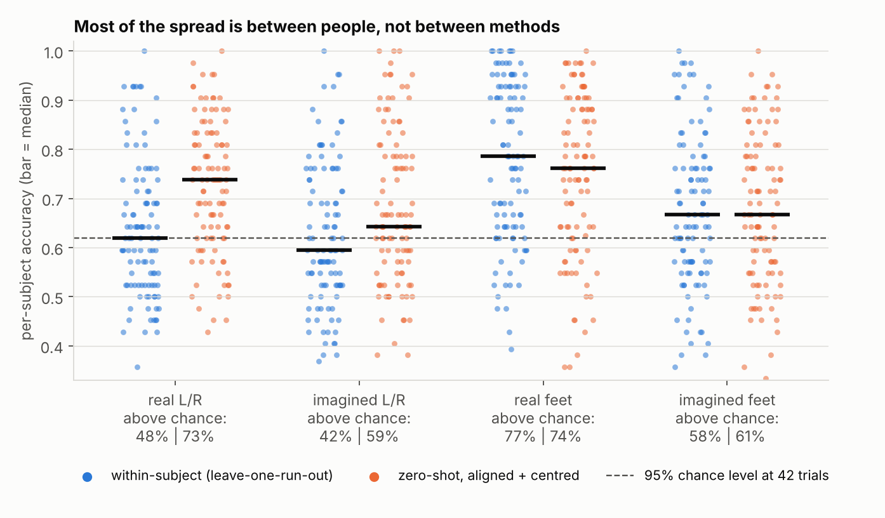

# CSP + LDA on EEGMMIDB: what preprocessing, alignment and calibration actually change

An exploratory, fully reproducible baseline study of a standard motor-imagery decoder (common spatial patterns + linear discriminant analysis) on the PhysioNet EEG Motor Movement/Imagery dataset, 105 subjects. It is a careful baseline, not a new method: the aim is to measure a few practical choices cleanly and to report what did not matter as plainly as what did.

## Summary

- **Aligning subjects is the main effect.** Pooling raw data from other people gives a zero-shot decoder that is near chance for real feet (54%). Euclidean Alignment lifts every task by 6 to 19 points (all Holm-corrected p < 0.0001), and a decoder trained on 104 other people then matches or beats one trained on the person's own recording.
- **Zero-shot beats within-subject for left/right, ties for feet.** Aligned and centred zero-shot accuracy is 72.5% vs 63.9% for real left/right and 68.4% vs 62.6% for imagined left/right, and the share of subjects above the chance level rises from 48% to 73% and from 42% to 59%. For real and imagined feet the two are statistically tied.
- **A few labelled calibration trials did not beat zero-shot with centring (for the simple adaptations tested).** Adapting the pooled model with 2 to 10 labelled trials per class is 1 to 4 points below zero-shot for left/right and imagined feet. Real feet is the one case that may benefit (up to +3.5 points at 10 trials per class), but that gain is not significant after correction. Starting from the pooled model clearly beats training from scratch on the same trials (by 10 to 17 points at 2 trials per class).
- **ICA artifact cleaning made no consistent difference.** Across 8 comparisons the effect is between -1.6 and +0.6 points and none survives correction. Using 21 motor channels instead of 42 was slightly better in all 8 comparisons (+0.1 to +3.1 points), significant only for real feet without ICA.
- **Feet are easier than left/right, and real is easier than imagined for feet.** Real feet 77.0% vs real left/right 63.9%; real feet vs imagined feet 77.0% vs 67.6%. For left/right, real and imagined do not differ significantly.
- **Individual differences dominate.** The spread across subjects (standard deviation about 14 to 18 points) is far larger than any method difference above, and with only about 42 trials per subject many individual accuracies cannot be told apart from guessing.

45 of the 80 pre-specified paired tests survive Holm correction. Effects are reported as differences with effect sizes, not only as p-values.

## Data and setup

**Dataset.** EEG Motor Movement/Imagery Dataset (Schalk et al. 2004; PhysioNet, Goldberger et al. 2000): 109 volunteers, 64 electrodes, 160 Hz, 14 runs each. Runs 3 to 14 are used. Subjects S088, S089, S092 and S100 are excluded because of known problems (S088, S092, S100 were recorded at 128 Hz; S089 has corrupted annotations), leaving 105. Each of the four tasks has three runs and about 42 trials per subject after epochs overlapping run boundaries are dropped.

| Task | Compared classes |
|---|---|
| real L/R | left fist vs right fist, executed |
| imagined L/R | left fist vs right fist, imagined |
| real feet | both fists vs both feet, executed |
| imagined feet | both fists vs both feet, imagined |

**Preprocessing, a 2 x 2 design.** Channel set (21 sensorimotor channels, or those plus 21 frontal and temporal channels) crossed with ICA cleaning (none, or FastICA with eye and muscle components removed). ICA is fitted once per subject on all 64 channels of the concatenated runs. EEGMMIDB has no dedicated EOG channel, so ocular components are identified through frontal electrodes (Fp1, Fp2, Fpz, AF7, AF8), and muscle components with MNE's detector at threshold 1.5. If more than 30% of components are flagged, only the ocular ones are removed. All conditions are then notch-filtered at 60 Hz and band-passed at 8 to 30 Hz. The four conditions are `motor_raw`, `motor_ica`, `hybrid_raw` and `hybrid_ica`. Unless stated otherwise, results use `motor_ica`.

**Windows.** Epochs are cut from 0 to 5.5 s after the cue and cropped to 18 analysis windows: the full 4 s task period (`0.0 - 4.0`, used for all headline results) and seventeen 1.5 s windows starting every 0.25 s from 0.0 to 4.0 s (used for timing).

**Decoder.** Six common spatial pattern filters (Ramoser et al. 2000) with Ledoit-Wolf shrinkage of the class covariances (Ledoit and Wolf 2004), log band power as features, then LDA with automatic shrinkage. The CSP step is computed from per-trial summary statistics instead of calling `mne.decoding.CSP`; `check_against_mne.py` compares the two implementations on real epochs (see Reproducing).

## How accuracy is measured

| Arm | What is trained | What is scored |
|---|---|---|
| within-subject | the person's own runs, leaving one run out in turn | the held-out run, averaged over runs |
| zero-shot, raw | all other subjects pooled as recorded | every trial of the held-out subject |
| zero-shot, aligned | all other subjects after Euclidean Alignment (He and Wu 2020) | every trial of the held-out subject |
| zero-shot, aligned + centred | as above, and each subject's features are shifted to zero mean | every trial of the held-out subject |

Euclidean Alignment rescales each subject's trials so that their average covariance becomes the identity. It uses no labels. Centring subtracts the subject's average feature vector, also without labels. **Both use the target person's unlabelled trials, including the ones that are scored, so they are transductive**: the system is assumed to observe some of the new user's data before decoding.

Calibration arms give the model `k` labelled trials per class from the held-out person (k = 2, 5, 10, drawn at random 10 times and averaged) and score on the person's remaining trials. All arms in a calibration comparison use the same draws and the same test trials.

| Calibration arm | What it does |
|---|---|
| from scratch | new CSP filters and a new LDA from the k trials only |
| pooled filters, new LDA | CSP filters from other subjects, a brand-new LDA from the k trials (the pooled classifier is discarded) |
| adapt: centre only | pooled filters and classifier; the person's features are centred using only the 2k calibration trials |
| adapt: centre + blend means | as above, and the classifier's class means are moved toward the person's own class means, the pooled means counting as 10 trials per class (a value fixed in advance, not tuned) |
| zero-shot, aligned + centred | reference: no labelled trials, centred with all the person's trials, scored on the same test trials |

**Statistics.** All comparisons are paired across the 105 subjects (Wilcoxon signed-rank, Pratt's treatment of zeros), chosen in advance in `stats.py`: 80 contrasts, corrected together with Holm's method (Holm 1979). Reported differences are in accuracy points, with the matched-pairs rank-biserial correlation as effect size in `results/stats_tests.csv`. Intervals in the figures are mean +/- 1.96 standard errors and are descriptive; the paired tests are the evidence, and the two can disagree for skewed differences.

## Results

### 1. Cross-subject transfer



| method | real L/R | imagined L/R | real feet | imagined feet |
|---|---|---|---|---|
| within-subject (leave-one-run-out) | 0.639 | 0.626 | 0.770 | 0.676 |
| zero-shot, raw | 0.617 | 0.600 | 0.541 | 0.608 |
| zero-shot, aligned | 0.717 | 0.679 | 0.734 | 0.673 |
| zero-shot, aligned + centred | 0.725 | 0.684 | 0.745 | 0.681 |

- Alignment improves on raw pooling by +10.0 (real L/R), +7.9 (imagined L/R), +19.4 (real feet) and +6.4 (imagined feet) points, all Holm p < 0.0001. Raw pooling for real feet is almost at chance (54.1%) while its within-subject accuracy is 77.0%, which is what a pooled model dominated by between-subject differences would look like. The mechanism was not tested directly.
- Centring adds 0.6 to 1.0 points on top of alignment, and none of these gains is significant after correction.
- Aligned and centred zero-shot against within-subject: +8.6 points for real L/R (Holm p < 1e-7) and +5.9 for imagined L/R (p < 1e-5) in favour of zero-shot; real feet is 2.5 points in favour of within-subject and imagined feet 0.5 points in favour of zero-shot, neither significant.

### 2. Calibration



Mean accuracy at each number of labelled trials per class (k):

| task | k | from scratch (k trials only) | pooled filters, new LDA | adapt: centre only | adapt: centre + blend means | zero-shot, aligned + centred |
|---|---|---|---|---|---|---|
| real L/R | 2 | 0.523 | 0.550 | 0.703 | 0.689 | 0.725 |
| real L/R | 5 | 0.572 | 0.641 | 0.713 | 0.692 | 0.725 |
| real L/R | 10 | 0.607 | 0.671 | 0.719 | 0.696 | 0.724 |
| imagined L/R | 2 | 0.522 | 0.550 | 0.664 | 0.653 | 0.683 |
| imagined L/R | 5 | 0.559 | 0.615 | 0.674 | 0.650 | 0.683 |
| imagined L/R | 10 | 0.577 | 0.634 | 0.681 | 0.649 | 0.686 |
| real feet | 2 | 0.601 | 0.629 | 0.726 | 0.743 | 0.744 |
| real feet | 5 | 0.711 | 0.749 | 0.736 | 0.765 | 0.743 |
| real feet | 10 | 0.752 | 0.774 | 0.738 | 0.776 | 0.742 |
| imagined feet | 2 | 0.559 | 0.586 | 0.663 | 0.657 | 0.680 |
| imagined feet | 5 | 0.615 | 0.640 | 0.673 | 0.664 | 0.682 |
| imagined feet | 10 | 0.637 | 0.664 | 0.673 | 0.665 | 0.678 |

- **Using the pooled model beats starting from scratch.** Adapting the pooled model (centre + blend means) is better than from scratch by 16.6, 13.0, 14.2 and 9.8 points at k = 2 for real L/R, imagined L/R, real feet and imagined feet. The gap narrows as k grows and is no longer significant for real feet at k = 10 (+2.4 points, Holm p = 0.19).
- **Discarding the pooled classifier is a poor way to calibrate.** Pooled filters with a new LDA are 9 to 17 points below zero-shot at k = 2 for left/right and imagined feet. This is the setup that makes calibration look harmful; it measures how little 4 trials can teach a classifier, not whether calibration helps.
- **No labelled arm beat zero-shot with centring, except possibly for real feet.** For left/right and imagined feet, adaptation is 1 to 4 points below it (significant at every k for left/right, at k = 2 and 5 for imagined feet). For real feet adaptation is tied at k = 2 and 5 and 3.5 points above at k = 10, which is not significant after correction (Holm p = 0.44).
- **Blending in the person's class means made left/right worse** than centring alone (by 1.2 to 3.1 points, significant at every k), and helped real feet (1.7 to 3.9 points, significant only at k = 2). A plausible reason is that class means from 2 to 10 trials are noisier than the class separation when that separation is small; this was not tested.
- **Centring from only the 2k calibration trials costs a little against centring from every trial:** about 2 points at k = 2 (for example 70.3% vs 72.5% for real L/R), about 1 point at k = 5 and 0.5 points or less at k = 10. The calibration trials are class-balanced by construction, which a real unlabelled stream would not guarantee.

In this setup, alignment plus centring was hard to beat with 2 to 10 labelled trials per class. That does not show that calibration is useless. The adaptation tested here is narrow (only the classifier's class means move; nothing is refitted), its blend weight was not tuned, k stops at 10, and deployed systems typically calibrate with more data, over longer sessions, with the user also adapting. Note also that the zero-shot reference is not data-free: alignment and centring already use the person's unlabelled trials, which is itself a form of calibration. A fairer test of labelled calibration would refit the pooled model with the person's trials added and upweighted, extend k, and sweep the blend weight, reporting every value. Real feet, a strong-signal task where the gain was largest, is the most promising place to look.

### 3. Preprocessing



| factor | task | setting | effect (points) | 95% interval (points) |
|---|---|---|---|---|
| ICA vs no ICA | real L/R | motor channels | -1.20 | ±1.35 |
| ICA vs no ICA | real L/R | hybrid channels | 0.14 | ±1.43 |
| ICA vs no ICA | imagined L/R | motor channels | -0.73 | ±1.01 |
| ICA vs no ICA | imagined L/R | hybrid channels | -1.59 | ±1.49 |
| ICA vs no ICA | real feet | motor channels | -0.67 | ±0.87 |
| ICA vs no ICA | real feet | hybrid channels | 0.56 | ±0.93 |
| ICA vs no ICA | imagined feet | motor channels | 0.11 | ±0.91 |
| ICA vs no ICA | imagined feet | hybrid channels | 0.25 | ±1.31 |
| 21 motor vs 42 channels | real L/R | no ICA | 1.47 | ±1.59 |
| 21 motor vs 42 channels | real L/R | ICA | 0.14 | ±1.64 |
| 21 motor vs 42 channels | imagined L/R | no ICA | 1.11 | ±1.89 |
| 21 motor vs 42 channels | imagined L/R | ICA | 1.97 | ±1.72 |
| 21 motor vs 42 channels | real feet | no ICA | 3.07 | ±1.53 |
| 21 motor vs 42 channels | real feet | ICA | 1.85 | ±1.47 |
| 21 motor vs 42 channels | imagined feet | no ICA | 1.72 | ±1.61 |
| 21 motor vs 42 channels | imagined feet | ICA | 1.59 | ±1.49 |

- **ICA:** effects between -1.6 and +0.6 points. None is significant after correction (smallest Holm p = 0.82). One interval in the figure (imagined L/R, 42 channels) excludes zero, but the pre-specified Wilcoxon test does not (uncorrected p = 0.14).
- **Channel set:** 21 motor channels were better than 42 in all 8 comparisons, by 0.1 to 3.1 points. Only real feet without ICA is significant after correction (+3.1 points, Holm p = 0.0017). More channels mean more parameters to estimate from about 28 training trials, which is a plausible explanation.
- This is a statement about this ICA configuration on this dataset, not about artifact removal in general.

### 4. Task type

- Real feet vs real L/R: +13.1 points (Holm p < 1e-8). Imagined feet vs imagined L/R: +5.0 points (p = 0.002).
- Real vs imagined: feet +9.4 points (p < 1e-6). For left/right the difference is +1.3 points and not significant.

### 5. Timing



Within-subject accuracy for 1.5 s windows by start time (seconds after the cue):

| window start (s) | real L/R | imagined L/R | real feet | imagined feet |
|---|---|---|---|---|
| 0.000 | 0.599 | 0.601 | 0.663 | 0.612 |
| 0.250 | 0.620 | 0.610 | 0.723 | 0.648 |
| 0.500 | 0.607 | 0.602 | 0.754 | 0.676 |
| 0.750 | 0.620 | 0.586 | 0.762 | 0.677 |
| 1.000 | 0.622 | 0.589 | 0.766 | 0.678 |
| 1.250 | 0.623 | 0.582 | 0.755 | 0.666 |
| 1.500 | 0.622 | 0.582 | 0.744 | 0.651 |
| 1.750 | 0.618 | 0.576 | 0.747 | 0.636 |
| 2.000 | 0.614 | 0.582 | 0.744 | 0.632 |
| 2.250 | 0.613 | 0.574 | 0.740 | 0.628 |
| 2.500 | 0.610 | 0.560 | 0.730 | 0.624 |
| 2.750 | 0.606 | 0.563 | 0.722 | 0.629 |
| 3.000 | 0.593 | 0.568 | 0.710 | 0.616 |
| 3.250 | 0.583 | 0.549 | 0.701 | 0.615 |
| 3.500 | 0.561 | 0.552 | 0.688 | 0.585 |
| 3.750 | 0.560 | 0.552 | 0.682 | 0.576 |
| 4.000 | 0.578 | 0.548 | 0.675 | 0.559 |

- The feet tasks peak for windows starting about 0.75 to 1.0 s after the cue and decline steadily; windows starting after about 2.5 s extend past the end of the 4 s task period and lose accuracy.
- Left/right is nearly flat from 0.25 to 2.5 s for real movement and weak throughout for imagined movement.
- The Friedman test rejects equal accuracy across the 17 windows for every task (all p < 1e-6), but it does not say which windows differ, and the best window is selected on the same data it is scored on, so the peak values are optimistic.
- The full 4 s window (see the transfer table) is better than any 1.5 s window for real left/right, mostly because longer windows give better covariance estimates, not because of timing.

### 6. Individual differences and chance level



| task | method | mean | sd | share above chance |
|---|---|---|---|---|
| imagined feet | zero-shot, aligned + centred | 0.681 | 0.154 | 61% |
| imagined feet | within-subject (leave-one-run-out) | 0.676 | 0.156 | 58% |
| imagined L/R | zero-shot, aligned + centred | 0.684 | 0.156 | 59% |
| imagined L/R | within-subject (leave-one-run-out) | 0.626 | 0.146 | 42% |
| real feet | zero-shot, aligned + centred | 0.745 | 0.175 | 74% |
| real feet | within-subject (leave-one-run-out) | 0.770 | 0.167 | 77% |
| real L/R | zero-shot, aligned + centred | 0.725 | 0.135 | 73% |
| real L/R | within-subject (leave-one-run-out) | 0.639 | 0.141 | 48% |

With about 42 trials, a subject needs roughly 62% accuracy to beat guessing at the 95% level, and under pure guessing only about 5% of subjects would pass. Even for real feet, about a quarter of subjects (23% within-subject, 26% zero-shot) do not exceed that level. Zero-shot transfer raises the share above chance most for left/right (48% to 73% real, 42% to 59% imagined), which is the practical benefit of borrowing other people's data. The threshold uses each subject's total number of trials, so it is approximate for averaged fold accuracies.

## Limitations

- **Transductive steps.** Alignment and centring use the target person's unlabelled trials, including the scored ones.
- **ICA uses all of a subject's runs,** including the held-out one. No labels are involved, but a strict pipeline would fit it on training runs only. EEGMMIDB has no real EOG channel, so ocular detection relies on frontal electrodes.
- **One dataset, one decoder.** Results apply to CSP + LDA on EEGMMIDB. Other decoders (for example Riemannian or deep models) can behave differently, and the dataset has three runs per task from a single session.
- **No untouched test set.** Hyperparameters (6 components, 8 to 30 Hz, window grid) were fixed, not tuned, and the window comparison selects the best window on the same data.
- **Few trials per subject** (about 42 per task, about 14 per test run), so individual accuracies are noisy.
- **Visual cue confound.** The on-screen target appears on the left or right (or top or bottom), so very early windows may reflect visual responses to its position as well as motor intention.
- **Calibration** is tested only for the 4 s window and `motor_ica`, with k up to 10 per class and one family of cheap adaptations (centring and blending class means into the pooled LDA). Refitting the CSP and LDA on pooled plus upweighted target data was not tried. The blend weight of 10 trials was fixed in advance and not tuned; other values were not explored.
- **Windows past 4 s** include the rest period.

## Reproducing

```
pip install -r requirements.txt
python epoching.py --data-dir data/eegmmidb            # epochs for 4 conditions x 18 windows (slow, run once)
python analysis.py --data-dir data/eegmmidb --windows "0.0 - 4.0" "0.0 - 1.5" "0.25 - 1.75" ...   # all 18 window names
python stats.py                                        # results/stats_tests.csv
python make_figures.py                                 # figures/ and results/tables.md
python check_against_mne.py --data-dir data/eegmmidb   # compare CSP+LDA with MNE's implementation
pytest
```

`results/stats_tests.csv` holds all 80 paired tests (differences, effect sizes, raw and corrected p-values). `results/tables.md` holds the tables above, generated from the results file. The `analysis.py` step is resumable; delete its output file if you regenerate epochs.

## References

- Schalk, G., McFarland, D. J., Hinterberger, T., Birbaumer, N., Wolpaw, J. R. (2004). BCI2000: a general-purpose brain-computer interface (BCI) system. IEEE Transactions on Biomedical Engineering, 51(6), 1034-1043.
- Goldberger, A. L. et al. (2000). PhysioBank, PhysioToolkit, and PhysioNet: components of a new research resource for complex physiologic signals. Circulation, 101(23), e215-e220.
- Ramoser, H., Muller-Gerking, J., Pfurtscheller, G. (2000). Optimal spatial filtering of single trial EEG during imagined hand movement. IEEE Transactions on Rehabilitation Engineering, 8(4), 441-446.
- Ledoit, O., Wolf, M. (2004). A well-conditioned estimator for large-dimensional covariance matrices. Journal of Multivariate Analysis, 88(2), 365-411.
- He, H., Wu, D. (2020). Transfer learning for brain-computer interfaces: a Euclidean space data alignment approach. IEEE Transactions on Biomedical Engineering, 67(2), 399-410.
- Gramfort, A. et al. (2013). MEG and EEG data analysis with MNE-Python. Frontiers in Neuroscience, 7, 267.
- Holm, S. (1979). A simple sequentially rejective multiple test procedure. Scandinavian Journal of Statistics, 6(2), 65-70.
